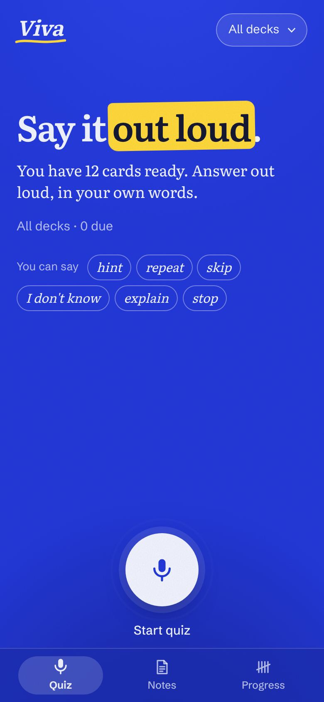
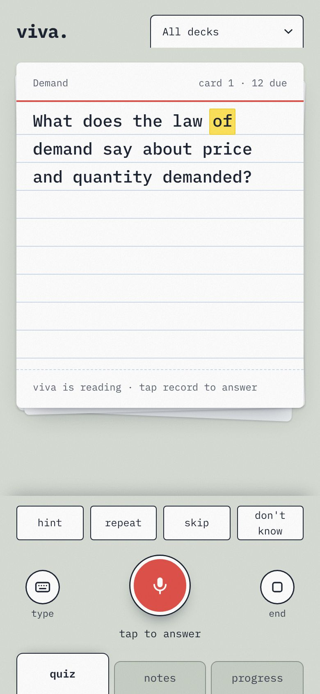
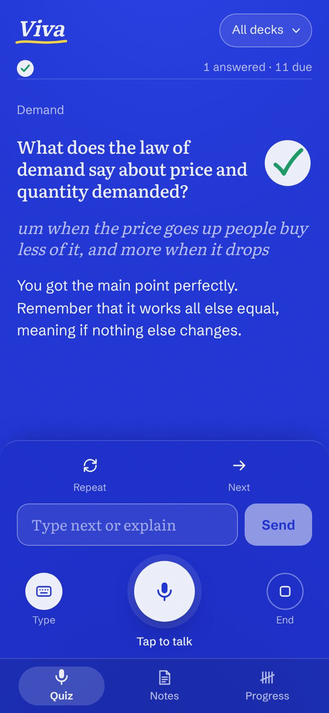
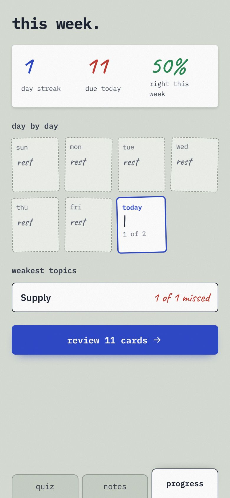
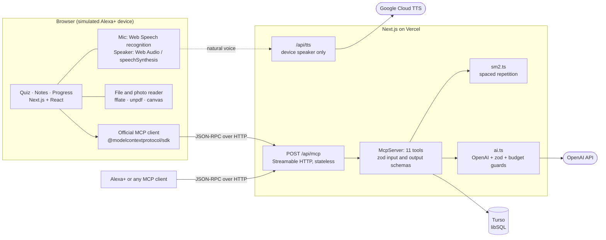
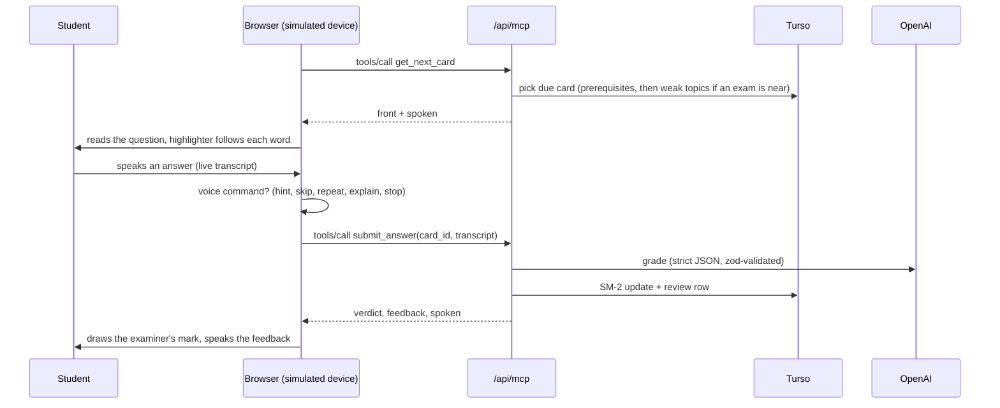

# Viva

**A voice-first study companion.** Add your notes, and Viva turns them into flashcards. It then quizzes you out loud, grades your spoken answers, and schedules reviews with spaced repetition.

**Live demo: [viva-mcp.vercel.app](https://viva-mcp.vercel.app)** · MCP endpoint: `https://viva-mcp.vercel.app/api/mcp` · [MIT license](LICENSE)

Built for the **Alexa+ track** of the Build, Ship, Shape: Amazon Developer Hackathon 2026. Viva is both **a real MCP server** that an Alexa+ device or any MCP client can connect to, and **a simulated Alexa+ experience** in the browser that calls that same server over MCP.

<table>
  <tr>
    <td></td>
    <td></td>
    <td></td>
    <td></td>
  </tr>
</table>

## Try it in 30 seconds

1. Open **[viva-mcp.vercel.app](https://viva-mcp.vercel.app)** on a phone or laptop. Chrome is best for voice. There's no sign-up: every visitor gets their own copy of a 12-card demo deck.
2. Tap the mic (**Start quiz**). Viva reads a question aloud, with a highlighter following each word.
3. Tap the mic again and answer in your own words. Try **hint**, **repeat**, **skip**, **I don't know**, **explain** or **stop**. If voice input isn't available, tap **Type**.
4. Open **Notes** to make your own deck. Paste text, take a photo of handwritten notes, or upload a PDF, Word file or slide deck.
5. Check **Progress** for your streak, a tally of the week, and your weakest topics.

To talk to the MCP server directly, see [Connect an MCP client](#connect-an-mcp-client).

## How Viva meets the Alexa+ track requirements

| Requirement | Where |
|---|---|
| MCP over Streamable HTTP, spec version `2025-11-25` or later | `src/app/api/mcp/route.ts` serves `McpServer` with `WebStandardStreamableHTTPServerTransport` (stateless). `initialize` negotiates `2025-11-25`, and `npm run mcp:smoke` prints the negotiated version. |
| MCP is imported and called at runtime, not only described | The server: `src/lib/mcp/server.ts` (11 tools). The client: `src/lib/client/mcp.ts`, where the web app's every study action goes through the official MCP `Client` over HTTP. |
| Simulated Alexa+ experience | The Quiz screen: browser mic and speaker, voice commands, and spoken replies, all through the MCP endpoint. |
| A real Alexa+ device could connect | Streamable HTTP plus `2025-11-25`, ready for Amazon's MCP Toolkit. See [Connecting to Alexa+](#connecting-to-alexa) for the add-on setup and what's still open. |
| Open-source license | [MIT](LICENSE) |
| Free to test, with no login | Anonymous per-browser user and a seeded demo deck; daily AI budget caps keep it free. |
| Setup and run instructions | [Setup](#setup) and [Deploy to Vercel](#deploy-to-vercel) below. |
| Product feedback and friction log | [docs/PRODUCT_FEEDBACK.md](docs/PRODUCT_FEEDBACK.md) and [docs/FRICTION_LOG.md](docs/FRICTION_LOG.md) |

## Architecture



One voice turn, as the simulation runs it:



## MCP tools

Every tool returns structured data plus a `spoken` string written for text-to-speech: plain sentences, no markdown, at most three sentences.

| Tool | Inputs | What it does |
|---|---|---|
| `list_decks` | none | The user's decks with card and due counts. |
| `add_material` | `title`, `text`, optional `exam_date` | Generates cards from notes with AI and saves a deck. Returns the card count, topics, and cards. |
| `get_next_card` | optional `deck_id`, `study_ahead`, `exclude_card_ids` | The next card's **front only**, plus its id and a `reason`. Unanswered prerequisite cards come first. When a deck's exam is within 21 days, due cards from the weakest topics are pulled forward, more strongly as the exam gets closer. If nothing is due, it says so and offers to study ahead. |
| `submit_answer` | `card_id`, `answer`, optional `hints_used` | AI grades the transcribed answer and updates the SM-2 schedule. Returns the verdict and spoken feedback, plus the correct answer if the user was wrong. A correct answer that needed hints scores lower. After a card is missed twice, the result sets `suggest_explain`. "I don't know" is graded without an AI call. |
| `get_progress` | optional `deck_id`, `timezone` | Streak, cards due today, 7-day accuracy, a per-day tally for the week, and the weakest topics. |
| `set_exam_date` | `deck_id`, `date` (ISO) | Stores the exam date. |
| `delete_card` | `card_id` | Deletes a bad card. The notes screen uses this. |
| `get_hint` | `card_id`, optional `level` (1–3) | A hint ladder: a nudge, then a strong cue, then part of the answer. All three hints come from one AI call and are stored on the card, so they are never regenerated. |
| `explain_again` | `card_id` | Re-explains a missed card from a different angle, with an everyday example, and adds an easier prerequisite card to the deck that comes up next. Generated once per card. |
| `get_study_nudge` | optional `deck_id`, `timezone` | A short proactive suggestion based on the nearest exam date, cards due, the streak, and the weakest topic. It is spoken when a quiz session starts. No AI is used. |
| `read_notes_photo` | `image` (JPEG, PNG or WebP data URL) | Transcribes a photo of handwritten or printed notes into text, ready for `add_material`. The web app downscales photos before sending them. |

Tool errors (budget reached, unknown card, AI unavailable) come back as `isError: true` results with a friendly spoken message, plus a machine-readable code in `_meta["viva/error"]`. Raw exceptions are never returned.

**Users.** There is no sign-up. Each browser gets an anonymous id in the `viva_user` cookie, and the web app sends it as the `x-viva-user` header. MCP clients that omit the header act as the shared `demo` user. Every new user automatically gets their own copy of a 12-card demo deck ("Supply and demand basics"), so the quiz works with one tap.

## Connect an MCP client

```bash
# initialize (protocol 2025-11-25 is negotiated)
curl -s -X POST https://viva-mcp.vercel.app/api/mcp \
  -H 'content-type: application/json' -H 'accept: application/json, text/event-stream' \
  -d '{"jsonrpc":"2.0","id":1,"method":"initialize","params":{"protocolVersion":"2025-11-25","capabilities":{},"clientInfo":{"name":"curl","version":"1"}}}'

# list tools
curl -s -X POST https://viva-mcp.vercel.app/api/mcp \
  -H 'content-type: application/json' -H 'accept: application/json, text/event-stream' \
  -H 'mcp-protocol-version: 2025-11-25' \
  -d '{"jsonrpc":"2.0","id":2,"method":"tools/list"}'

# ask for the next card, as a specific user
curl -s -X POST https://viva-mcp.vercel.app/api/mcp \
  -H 'content-type: application/json' -H 'accept: application/json, text/event-stream' \
  -H 'mcp-protocol-version: 2025-11-25' -H 'x-viva-user: judge-1' \
  -d '{"jsonrpc":"2.0","id":3,"method":"tools/call","params":{"name":"get_next_card","arguments":{}}}'
```

- If `MCP_API_KEY` is set on a deployment, add `-H 'authorization: Bearer <key>'`. It is not set on the public demo.
- `x-viva-user` picks the user. Without it, calls act as the shared `demo` user.

The repo includes a smoke test that runs the voice loop with the official MCP client:

```bash
npm run mcp:smoke -- https://viva-mcp.vercel.app/api/mcp
```

You can also use the MCP Inspector (`npx @modelcontextprotocol/inspector`). Choose the "Streamable HTTP" transport and the URL above.

The server is **stateless**: each POST gets a fresh server and transport, and no session id is issued, which fits serverless functions. `GET` and `DELETE` return 405, as the spec allows for servers that offer no standalone SSE stream.

**Server instructions** returned by `initialize` describe the voice loop for an agent: call `get_next_card`, read `spoken` aloud, send the transcript to `submit_answer`, offer `get_hint` and `explain_again`, and open the session with `get_study_nudge`.

## Connecting to Alexa+

The web app is one client of the MCP server, standing in for a voice device. On a real Alexa+ device, **Alexa+ is the MCP client**. You talk to Alexa, not to the web app:

1. "Alexa, quiz me on my biology notes." Alexa+ turns the speech into text, its AI picks Viva's `get_next_card` tool, and it reads back the `spoken` line in its own voice.
2. You answer to Alexa. Alexa+ sends the transcript to `submit_answer` and speaks Viva's feedback.
3. "Give me a hint", "explain that" and "how am I doing?" map to `get_hint`, `explain_again` and `get_progress`.

You'd still use the web app to add notes (a voice device can't take a PDF) and to see the progress tally. Both read the same database.

### Readiness

| Alexa+ MCP Toolkit requirement | Viva today |
|---|---|
| Streamable HTTP (the legacy HTTP+SSE transport isn't accepted) | Yes. Stateless Streamable HTTP at `/api/mcp`. |
| MCP spec `2025-11-25` | Yes. Negotiated on `initialize`. |
| Reachable at a remote HTTPS URL | Yes. `https://viva-mcp.vercel.app/api/mcp` |
| Responses designed for voice | Yes. Every tool returns a `spoken` line of at most three plain sentences, and the server's `instructions` describe the voice loop. |
| Visuals | Not needed. Text-only add-ons are supported; MCP Apps is optional. |
| Round trips under 500 ms | **Partly.** Reading tools (`get_next_card`, `get_progress`, `get_study_nudge`, stored hints) answer in about 75–160 ms on the live site. `submit_answer` takes 1–2 s because grading is an AI call, and `add_material` takes 10–30 s. Card-making belongs in the web app anyway. For grading, the next step is a faster model, or quick answers for clear-cut cases. |
| Per-user sign-in (OAuth 2.1 account linking) | **Not yet.** The web app identifies users by an anonymous cookie id, sent as `x-viva-user`. Alexa+ won't send that header, so Alexa+ calls would use the shared `demo` account. See [Account linking plan](#account-linking-plan). |

### Deploying it as an Alexa+ add-on

Amazon's [MCP Toolkit](https://developer.amazon.com/docs/alexaplus/add-ons/mcp-toolkit-overview.html) wraps an existing MCP server in an "add-on". It's currently available in the United States, and Amazon is onboarding partners in stages. Following the [quickstart](https://developer.amazon.com/docs/alexaplus/add-ons/mcp-toolkit-quickstart.html):

```bash
alexa-ai configure                      # sign in with Login with Amazon
alexa-ai new mcp --name "Viva" --locale en-US \
  --mcp-server-url https://viva-mcp.vercel.app/api/mcp
# fill in addon-package/addon.json: listing, example phrases, icons, privacy and terms URLs
alexa-ai deploy                         # development stage; test in the simulator or on a device
```

The part of `addon.json` that points Alexa+ at Viva (an excerpt; the CLI scaffolds the full file):

```json
{
  "integrations": [
    {
      "type": "MCP",
      "config": {
        "endpoints": {
          "default": { "type": "HTTPS", "uri": "https://viva-mcp.vercel.app/api/mcp" }
        }
      }
    }
  ]
}
```

Example phrases for the listing: "Quiz me on my notes", "Give me a hint", "How am I doing this week?", "When is my exam?"

Alexa+ refreshes tool information only on deployment, so run `alexa-ai deploy` again after changing tools.

### Account linking plan

To make a student's Alexa+ device and their phone share one account, Viva would add what the toolkit expects for authenticated servers:

1. **A Viva sign-in.** It stays optional, so the web app stays free to try with no login. Signing in adopts the anonymous cookie user, so existing decks carry over.
2. **An OAuth 2.1 authorization server** using the authorization code flow with PKCE (`S256`), honoring the `resource` parameter. Its metadata is published at `/.well-known/oauth-authorization-server`, and the protected resource metadata at `/.well-known/oauth-protected-resource` (RFC 9728).
3. **Per-user bearer tokens on `/api/mcp`.** The token maps to the same user id the web app uses, so `x-viva-user` stays only for the anonymous web demo. Requests without a token keep working as the demo user, and sign-in-only tools would return 401.

The existing `MCP_API_KEY` is a single shared key that protects a private deployment. It doesn't identify users, so it's not a substitute.

## How the simulation works

The quiz screen plays the part of an Alexa+ device:

1. **Start quiz** (one tap) calls `get_next_card` through the MCP client and reads the question aloud. A highlighter bar follows the spoken word.
   - **Voice:** with `GOOGLE_TTS_API_KEY` set, speech comes from Google Cloud Text-to-Speech (a Chirp 3 HD voice) through `/api/tts`, and is played with Web Audio. The highlighter is timed against the audio clock: it uses exact word timings for voices that report them and estimates them from the audio length for the others. Identical sentences are cached by the CDN.
   - **Fallback:** without the key, or when the daily voice budget is spent, the browser's `speechSynthesis` speaks instead, driven by boundary events or a conservative timed sweep. `/api/tts` is only the simulated device's speaker; all study logic goes through MCP.
2. Tap the mic to answer. `SpeechRecognition` (or `webkitSpeechRecognition`) shows the live transcript. Recognition stops on silence or when you tap again. On desktop, the mic circle swells with the input level from a Web Audio analyser. On phones, it breathes with recognition events instead, because phones can't share the microphone between `getUserMedia` and speech recognition.
3. The transcript is first checked for voice commands: **hint**, **repeat**, **skip**, **I don't know**, **explain**, **next**, **stop**, and **study ahead**. Anything else is sent to `submit_answer`.
4. The examiner's mark (tick, partial circle, or cross) is drawn once, and the `spoken` feedback is read aloud.
   - After a correct answer, the next question follows automatically.
   - After a miss, a countdown gives you time to say "explain" first.
   - When a card keeps being missed, the explain button is highlighted and the session waits for you.
5. The first tap of a session speaks the `get_study_nudge` suggestion, for example "Your exam is in 5 days. Elasticity needs the most work, so I'll start there." Ending a session shows a summary with a tally of correct answers.

Fallbacks: if speech recognition isn't available (for example, some iPhone browsers), or the microphone is blocked, a text box appears, and questions are still read aloud. "No speech", network failures, and the daily demo limit each show a plain message that says what to do next.

## Adding notes

The notes screen accepts pasted text, a photo, or a file. Files are turned into text **in the browser**, and only the text is sent to `add_material`, so large slide decks never hit request limits:

| File | How it's read |
|---|---|
| PDF | `unpdf` (a serverless build of PDF.js), loaded only when a PDF is chosen. Scanned PDFs have no text layer, so photograph those pages instead. |
| Word `.docx`, PowerPoint `.pptx`, Excel `.xlsx`, OpenDocument `.odt/.odp/.ods` | Unzipped with `fflate`; paragraphs are read from the XML. Slides come in order, each followed by its speaker notes. |
| RTF, HTML, Markdown, plain text, CSV, subtitles, and any other text file | Read directly, with markup stripped. |
| Images (JPEG, PNG, WebP) | Sent to `read_notes_photo` after the browser downscales them. |
| Old binary `.doc/.ppt/.xls`, Apple iWork | Not supported. Viva says how to convert them (save as `.docx`, `.pptx` or PDF). |

## Spaced repetition

`src/lib/sm2.ts` implements SM-2 on quality 0–5 (correct = 5, or 4 if the transcript sounds hesitant; partial = 3; incorrect = 1):

- quality < 3: repetitions reset to 0, the interval becomes 1 day, and lapses increase by 1
- otherwise: the interval goes 1 day, then 6 days, then `previous_interval × ease`
- `ease = max(1.3, ease + 0.1 − (5 − q)(0.08 + (5 − q) × 0.02))`

One addition: a missed card keeps the 1-day SM-2 interval, but its `due_at` is set 10 minutes ahead (a relearning step), so it comes back later in the same session. Unit tests are in `tests/`.

## AI and budget guards

All AI calls go through `src/lib/ai.ts` (OpenAI, default model `gpt-4.1-mini`, which you can override with `OPENAI_MODEL`). Outputs use strict JSON schema, are validated with zod, and are retried once if invalid.

- Notes are truncated to 24,000 characters and split into chunks of about 6,000 characters, one call per chunk. Each call produces 8 to 20 cards.
- Before **every** AI call, the `usage` table is checked and incremented for a global daily cap (`AI_DAILY_CALL_CAP`) and a per-user daily cap (`AI_SESSION_DAILY_CAP`). When either cap is reached, tools return "Demo limit reached for today…" in both the UI and `spoken`.
- Everything AI makes is generated once and stored: cards, the three hints for a card, and its re-explanation. None of it is regenerated. "I don't know" answers, study nudges, and progress use no AI at all.
- Spoken answers are truncated to 1,000 characters, and photos are downscaled in the browser before upload.
- Speech has its own budget: `TTS_DAILY_CHAR_CAP` characters a day, and the CDN caches repeated sentences.

## Setup

Requirements: Node.js 20.12 or later, a [Turso](https://turso.tech) database, and an OpenAI API key.

```bash
git clone https://github.com/Nana-Kojo801/viva-mcp.git
cd viva-mcp
npm install
cp .env.example .env.local   # then fill it in
npm run db:setup             # optional: the server also creates the schema on first request
npm run dev                  # http://localhost:3000
```

For local development without Turso, set `TURSO_DATABASE_URL=file:viva.db` to use a local SQLite file. Don't do this in production, because serverless file systems are wiped between requests.

### Environment variables

| Variable | Required | Description |
|---|---|---|
| `OPENAI_API_KEY` | yes | Used for card generation and grading. Server only; it is never sent to the browser. |
| `OPENAI_MODEL` | no | Overrides the model. The default is `gpt-4.1-mini`. |
| `TURSO_DATABASE_URL` | yes | `libsql://<db>-<org>.turso.io` |
| `TURSO_AUTH_TOKEN` | yes for Turso | Database auth token. |
| `MCP_API_KEY` | no | When set, external MCP clients must send `Authorization: Bearer <key>`. The Viva web app's same-origin browser requests are allowed without it. |
| `AI_DAILY_CALL_CAP` | no | Global AI calls per day (UTC). The default is 300. |
| `AI_SESSION_DAILY_CAP` | no | AI calls per user per day. The default is 40. |
| `GOOGLE_TTS_API_KEY` | no | Google Cloud API key with the Text-to-Speech API enabled. It gives the natural voice; without it, the browser voice is used. |
| `GOOGLE_TTS_VOICE` | no | The voice name. The default is `en-US-Chirp3-HD-Kore`. Non-Chirp voices (for example `en-US-Neural2-F`) report exact word timings. |
| `TTS_DAILY_CHAR_CAP` | no | Characters of speech per day across all visitors. The default is 30,000, about 900k a month, which stays inside the free tier. |

### Create the Turso database

From the Turso dashboard (works on a phone): create a database, open it, copy the **URL** (`libsql://…`), and create a **token**. Or use the CLI:

```bash
turso db create viva
turso db show viva --url
turso db tokens create viva
```

### Get a Google Cloud Text-to-Speech key (optional, for the natural voice)

1. In the [Google Cloud console](https://console.cloud.google.com), create a project and enable **Cloud Text-to-Speech API**. A billing account is required, but the monthly free tier covers this demo.
2. Go to **APIs & Services → Credentials → Create credentials → API key**. Under **API restrictions**, restrict the key to Cloud Text-to-Speech API.
3. Add the key as `GOOGLE_TTS_API_KEY` in Vercel and redeploy.

### Deploy to Vercel

1. In Vercel, choose **Add New → Project** and import this GitHub repo. The framework preset is detected as Next.js, so the defaults need no changes.
2. Under **Environment Variables**, add `OPENAI_API_KEY`, `TURSO_DATABASE_URL`, `TURSO_AUTH_TOKEN`, and optionally `GOOGLE_TTS_API_KEY`, `AI_DAILY_CALL_CAP`, `AI_SESSION_DAILY_CAP`, `TTS_DAILY_CHAR_CAP`, and `MCP_API_KEY`. After changing a variable, redeploy so the functions pick it up.
3. Deploy. The tables are created on the first request to `/api/mcp`.
4. Check it with `npm run mcp:smoke -- https://YOUR-APP.vercel.app/api/mcp`, or with the `curl` commands in [Connect an MCP client](#connect-an-mcp-client).

`/api/mcp` sets `maxDuration = 60`, so `add_material` has time for long notes on the Hobby plan.

## Testing

```bash
npm test             # 41 unit tests: SM-2, budget caps, AI parsing and retry, store and card selection, voice commands
npm run lint         # type check
npm run build        # production build
npm run mcp:smoke -- https://viva-mcp.vercel.app/api/mcp
```

Run this checklist on a phone (Chrome on Android) before each submission. The automated tests already cover the scheduling ("a wrong answer comes back sooner"), the budget caps, and command matching.

- [ ] Paste notes, get cards, delete one.
- [ ] Upload a PDF or slide deck, and a photo of handwritten notes.
- [ ] Tap the mic, speak an answer, see the transcript, hear the feedback.
- [ ] Ask for a hint; miss a card and say "explain".
- [ ] Mic blocked: the typing fallback works.
- [ ] AI cap reached on purpose (set `AI_SESSION_DAILY_CAP=2` and redeploy): a friendly "demo limit reached" message appears. Then set it back.
- [ ] `initialize` and `tools/list` over `curl`: `2025-11-25` is negotiated.
- [ ] Cold-load the live URL in a private tab: the seeded deck's quiz starts in one tap.

## Project layout

```
src/app/api/mcp/route.ts    MCP endpoint (Streamable HTTP, stateless, optional bearer auth)
src/app/api/tts/route.ts    Simulated device speaker (Google Cloud TTS, cached, budgeted)
src/lib/mcp/server.ts       The 11 MCP tools and server instructions
src/lib/ai.ts               All AI calls: cards, grading, hints, re-explanations, photo transcription
src/lib/budget.ts           Daily AI call and speech character caps
src/lib/sm2.ts              Spaced repetition (SM-2)
src/lib/store.ts            Database queries, card selection, progress
src/lib/schema.ts, db.ts    Turso schema and migrations
src/lib/seed.ts             Demo deck
src/lib/tts.ts              Google Cloud TTS client
src/lib/client/mcp.ts       Browser MCP client and screen cache
src/lib/client/voice.ts     Speech in and out, the reading line timing, voice commands
src/lib/client/extract.ts   PDF, Office, OpenDocument, RTF and HTML text extraction
src/components/             Quiz, Notes, Progress, and the shared UI pieces
tests/                      Vitest unit tests
scripts/                    db:setup and the MCP smoke test
docs/                       Design plan, demo script, friction log, product feedback, screenshots
```

## Docs

- [docs/DESIGN.md](docs/DESIGN.md): the design system, motion, and the review against the brief
- [docs/DEMO_SCRIPT.md](docs/DEMO_SCRIPT.md): the 2-minute demo video script
- [docs/FRICTION_LOG.md](docs/FRICTION_LOG.md): what was confusing or broken, and suggestions
- [docs/PRODUCT_FEEDBACK.md](docs/PRODUCT_FEEDBACK.md): the tools used, what worked, and what needs work
- [docs/SUBMISSION.md](docs/SUBMISSION.md): the project description for the submission form

## License

MIT. See [LICENSE](LICENSE).
